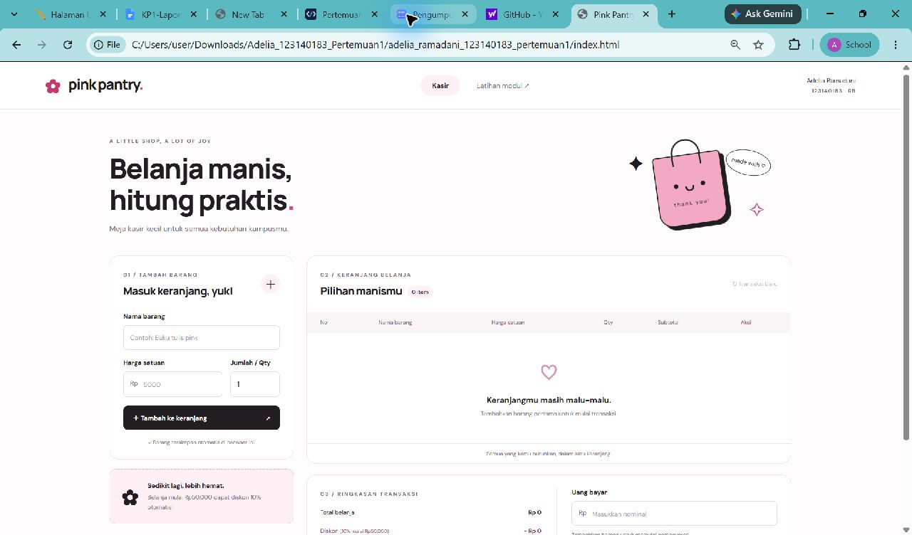
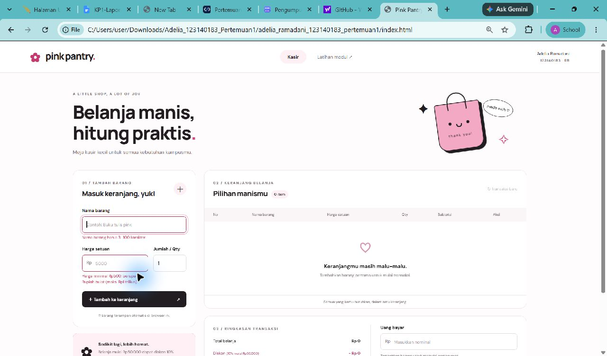
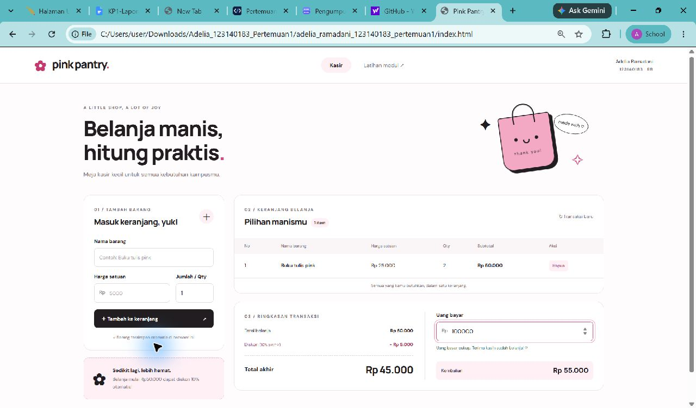

# Pink Pantry — Mini POS

**Nama:** Adelia Ramadani  
**NIM:** 123140183  
**Kelas Praktikum:** RB  
**Mata kuliah:** Praktikum Pengembangan Aplikasi Web, Teknik Informatika ITERA  
**Pertemuan:** 1 — JavaScript Dasar

## Deskripsi aplikasi

Pink Pantry adalah aplikasi kasir dan keranjang belanja sederhana untuk toko kebutuhan kampus. Kasir memasukkan barang, harga, dan jumlah; aplikasi menghitung total, diskon, serta kembalian secara langsung. Tema pink, hitam, dan putih dilengkapi ilustrasi tas belanja dari CSS, gerakan mengambang ringan, animasi penambahan barang, dan notifikasi singkat.

## Cara menjalankan

1. Unduh/clone repository `pemrograman_web_itera_123140183`.
2. Buka folder `Adelia Ramadani_123140183_pertemuan1` di VS Code.
3. Klik kanan `index.html`, pilih **Open with Live Server**. Gunakan alamat server dan browser yang sama untuk mempertahankan data localStorage.
4. Alternatif tanpa instalasi: klik dua kali `index.html`. Browser modern dapat menjalankan aplikasi langsung; perilaku localStorage pada alamat `file://` bergantung pada browser. Live Server lebih disarankan.
5. Klik **Latihan modul** untuk membuka semua latihan. Fitur Fetch API memerlukan koneksi internet. Font Google bersifat pelengkap; jika tidak tersedia, browser menggunakan font sans-serif bawaan.

Aplikasi menggunakan HTML, CSS, dan JavaScript murni; tidak membutuhkan npm, framework, backend, maupun proses build.

## Struktur folder

```text
Adelia Ramadani_123140183_pertemuan1/
├── index.html
├── style.css
├── script.js
├── README.md
├── modul/
│   ├── index.html
│   ├── modul.css
│   └── latihan.js
├── screenshots/
│   ├── 01-form-utama.jpg
│   ├── 02-validasi-error.jpg
│   └── 03-keranjang-perhitungan.jpg
└── tests/
    └── pos.test.cjs
```

## Fitur tugas utama

- [x] Nama barang wajib diisi, minimal 3 karakter (maksimal 100).
- [x] Harga wajib berupa angka positif, minimal Rp500, dalam Rupiah bulat.
- [x] Qty wajib bilangan bulat minimal 1.
- [x] Pesan merah tepat di bawah input yang salah; barang tidak ditambahkan jika tidak valid.
- [x] Form otomatis kembali kosong dan Qty kembali 1 setelah penambahan berhasil.
- [x] Tabel: No, Nama Barang, Harga Satuan, Qty, Subtotal, dan Aksi.
- [x] Subtotal otomatis = harga × Qty; total belanja = jumlah subtotal.
- [x] Diskon otomatis 10% jika total belanja minimal Rp50.000.
- [x] Nominal diskon dan total akhir ditampilkan dalam format Rupiah.
- [x] Input uang bayar menghitung kembalian otomatis, serta menunjukkan kekurangan pembayaran.
- [x] Hapus per barang langsung menghitung ulang total dan diskon.
- [x] Penyimpanan keranjang dengan `JSON.stringify()` dan pemuatan dengan `JSON.parse()`.
- [x] Tombol transaksi baru mengosongkan keranjang, pembayaran, dan kunci penyimpanan transaksi.
- [x] Tampilan responsif; tabel bisa digeser secara horizontal pada layar sempit.
- [x] HTML, CSS, dan JavaScript dipisahkan; animasi mengikuti preferensi reduced motion.
- [x] Penanganan JSON rusak, data tersimpan tidak valid, penyimpanan ditolak browser, dan sinkronisasi tab.

Catatan: uraian fitur PDF menyebut minimal Rp500, sedangkan tabel rubrik menulis `> 500`. Implementasi mengikuti persyaratan fitur yang eksplisit: Rp500 diterima. Harga dan uang bayar dibatasi Rp1 triliun, Qty maksimal 1.000.000, serta subtotal dan total transaksi maksimal Rp1 triliun untuk menjaga perhitungan tetap terkontrol. Diskon dibulatkan ke Rupiah terdekat menggunakan `Math.round()`.

## Penjelasan teknis

### Validasi form

Event `submit` dicegah menggunakan `preventDefault()`. Fungsi `validateItem()` memeriksa nama dengan `trim()`, harga dengan `Number.isSafeInteger()` dan batas minimum, serta Qty dengan pemeriksaan bilangan bulat. Setiap kesalahan dipetakan ke teks di bawah input terkait dan atribut `aria-invalid`. Fokus diarahkan ke input pertama yang salah. Jika valid, objek `{ id, name, price, qty }` ditambahkan ke array `cart`, data disimpan, tabel dirender ulang, lalu form di-reset.

### Algoritma kalkulator

Fungsi `calculateTotals()` menggunakan `reduce()` untuk menjumlahkan `price * qty`. Jika subtotal >= 50.000, diskon = `Math.round(subtotal * 0.1)`; total akhir = subtotal − diskon. `renderPayment()` menghitung uang bayar − total akhir. Jika pembayaran kurang, kembalian tetap Rp0 dan selisih kekurangan ditampilkan. Pembayaran kosong, negatif, pecahan, tidak valid, dan di luar batas ditangani terpisah.

Contoh: buku tulis Rp15.000 × 3 = Rp45.000; pulpen Rp10.000 × 3 = Rp30.000. Total Rp75.000, diskon Rp7.500, total akhir Rp67.500. Uang bayar Rp100.000 menghasilkan kembalian Rp32.500. Jika barang dihapus sehingga total di bawah Rp50.000, diskon otomatis menjadi nol.

### LocalStorage dan DOM

Kunci transaksi: `adelia.pinkPantry.cart.v1`. `saveCart()` menyimpan array sebagai JSON. `loadCart()` memuat, mengurai, dan memvalidasi struktur, ID unik, harga, Qty, serta total sebelum menampilkan ulang data. `try/catch` menangani kegagalan penyimpanan atau penguraian. Reset menggunakan `removeItem()` khusus kunci aplikasi ini, sehingga data modul/aplikasi lain tidak ikut terhapus. Event `storage` menyelaraskan keranjang ketika tab lain berubah. Jika beberapa tab menulis bersamaan, perubahan terakhir yang tersimpan digunakan.

Isi nama barang dan data dari pengguna/API dimasukkan lewat `textContent`, bukan HTML mentah. Uang bayar sengaja tidak disimpan agar tiap pembukaan halaman memerlukan pemeriksaan nominal pembayaran kembali.

## Latihan selama modul

Seluruh latihan dapat dicoba di `modul/index.html`; kode tersedia dalam `modul/latihan.js`.

| Bagian | Implementasi |
| --- | --- |
| Variabel dan kondisional | Data diri const/let; cek kelulusan >=70; kategori umur anak <12, remaja 12–17, dewasa 18–59, lansia >=60; konversi hari 1–7 memakai switch; grade memakai ternary |
| Loop dan fungsi | For/rata-rata, while/countdown, for…of, sapaan/event, kalkulator empat operasi, tabel perkalian 1–10, faktorial BigInt, cek prima, BMI, FizzBuzz 1–100 |
| Array dan objek | Push/pop/sort/map/filter/reduce; properti dan method objek, tambah/ubah/hapus properti; minimal lima mahasiswa, nilai tertinggi termasuk nilai seri, filter di atas rata-rata, urut A–Z/Z–A, CRUD dan validasi NIM unik |
| DOM dan API | Tambah/hapus/ubah warna elemen; form dan localStorage mahasiswa; todo tambah/hapus/selesai persisten; dark mode melalui class CSS; fetch async/await, pemeriksaan HTTP, timeout, pencarian judul, pagination Previous/Next |

Umur dan kota asal Adelia belum diberikan sehingga tersedia sebagai input, tanpa mengarang data pribadi. Mahasiswa lain dan seluruh nilai awal adalah data simulasi latihan, bukan catatan akademik nyata. Data mahasiswa/todo menggunakan kunci `adelia.lab.students` dan `adelia.lab.todos`.

## Tangkapan layar

### 1. Form input utama



### 2. Validasi error



### 3. Keranjang dan perhitungan



## Pengujian

Jalankan dari folder pertemuan jika Node.js tersedia:

```bash
node --test tests/pos.test.cjs
```

Delapan pengujian mencakup batas minimal Rp500, penolakan input tidak valid, keranjang kosong, subtotal gabungan, ambang diskon Rp50.000, skenario Rp75.000, perubahan diskon setelah hapus, dan batas subtotal. Semua delapan pengujian lulus saat pengerjaan.

Pengujian manual yang disarankan: tambah barang valid, coba nama pendek/harga kosong/Qty pecahan, ubah uang bayar, refresh halaman, hapus barang, lalu jalankan transaksi baru. Untuk modul, coba edit/hapus mahasiswa, refresh todo, dan ambil post dengan internet aktif.
