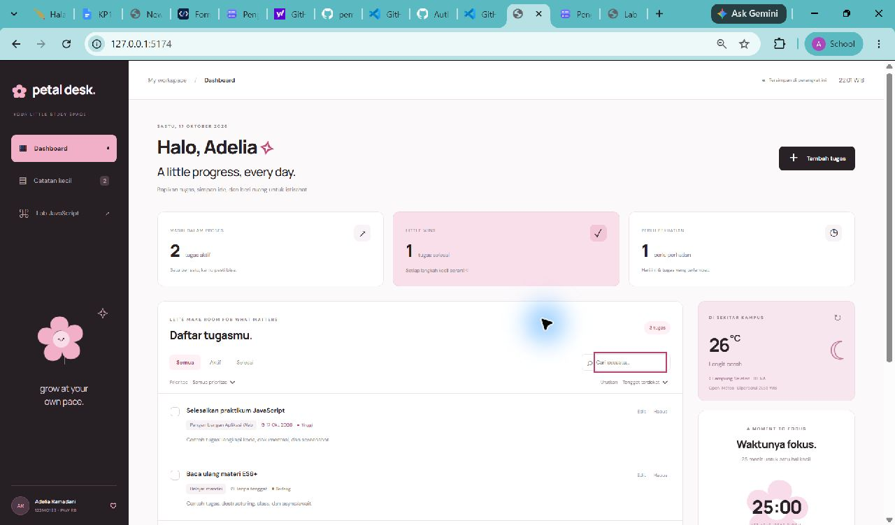
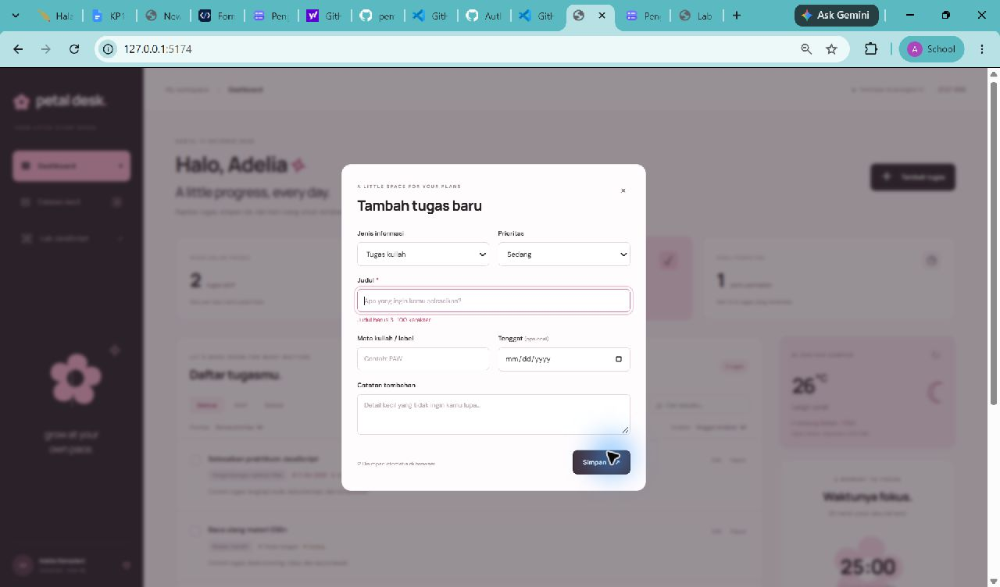
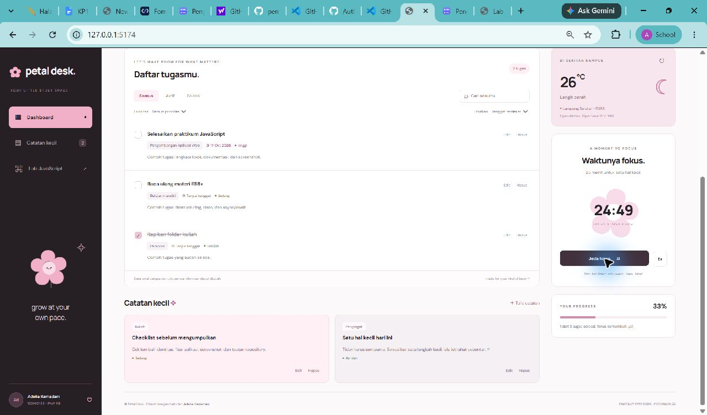
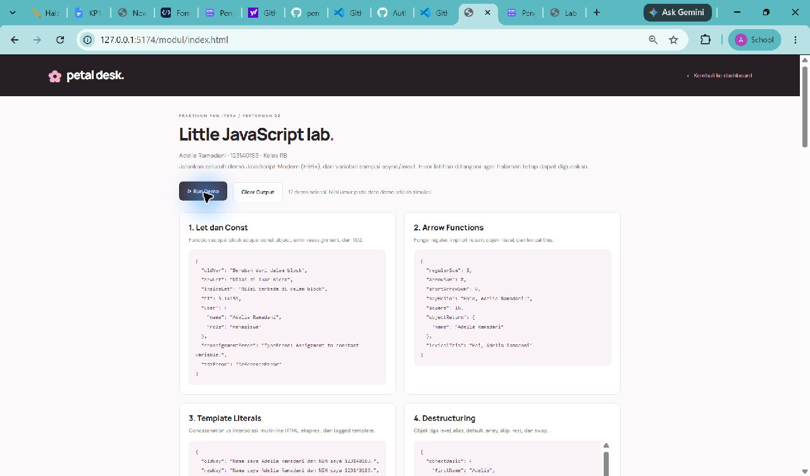

# Petal Desk — Personal Dashboard Mahasiswa

**Nama:** Adelia Ramadani  
**NIM:** 123140183  
**Kelas Praktikum:** RB  
**Pertemuan:** 2 — JavaScript Next Gen (ES6+)  
**Mata kuliah:** Praktikum Pengembangan Aplikasi Web, Teknik Informatika ITERA

## Fungsi aplikasi

Petal Desk adalah meja belajar digital untuk mengelola tugas kuliah dan catatan pribadi. Dashboard menampilkan tugas aktif, tugas selesai, tenggat yang perlu diperhatikan, progres penyelesaian, cuaca di sekitar kampus ITERA, dan timer fokus 25 menit. Tampilan menggunakan warna pink, hitam, dan putih, ilustrasi bunga dari CSS/teks, serta gerakan ringan yang dinonaktifkan ketika pengguna memilih reduced motion.

Studi kasus dipilih untuk membantu mahasiswa melihat prioritas belajar dalam satu tempat. Semua tugas dan catatan awal adalah **data contoh**, bukan jadwal atau catatan akademik Adelia yang sebenarnya. Data contoh dapat diedit dan dihapus; umur pada demo ES6+ juga merupakan simulasi.

## Cara menjalankan — wajib melalui HTTP

1. Buka folder `Adelia Ramadani_123140183_pertemuan2` di VS Code.
2. Klik kanan `index.html`, lalu pilih **Open with Live Server**.
3. Dashboard terbuka di alamat lokal Live Server. Klik **Lab JavaScript** untuk membuka latihan.

**Jangan membuka `index.html` dengan double-click / `file://`.** Proyek menggunakan `<script type="module">` dan import/export, sehingga browser memerlukan server HTTP untuk memuat modul dengan benar.

Alternatif tanpa memasang dependensi, jika Node.js tersedia:

```bash
npm start
```

Atau jalankan `node server.mjs`, lalu buka **http://127.0.0.1:5174**. Gunakan alamat, port, dan profil browser yang sama untuk membaca localStorage yang sama. Server ini hanya untuk pengembangan lokal dan dapat dihentikan dengan Ctrl+C.

Internet dibutuhkan untuk API cuaca dan latihan API riil. CRUD tugas/catatan tetap bisa digunakan ketika API gagal, selama berkas aplikasi sudah dimuat dari server lokal. Google Fonts bersifat pelengkap; tersedia font sans-serif bawaan sebagai pengganti. Tidak ada build, framework, API key, atau paket npm eksternal yang diperlukan.

## Fitur aplikasi

- [x] Tambah, baca, edit, dan hapus tugas kuliah.
- [x] Tambah, edit, dan hapus catatan pribadi.
- [x] Tandai tugas selesai atau kembalikan menjadi aktif.
- [x] Form memvalidasi judul 3–100 karakter, label maksimal 60 karakter, isi maksimal 1.500 karakter, serta tanggal kalender yang valid antara tahun 2000–2100.
- [x] Pencarian berdasarkan judul, label, dan isi; filter status dan prioritas; pengurutan tenggat atau nama.
- [x] Ringkasan aktif/selesai, jumlah tugas hari ini atau terlambat, serta persentase progres otomatis.
- [x] Penyimpanan dengan localStorage, pemulihan instance class setelah refresh, dan pembaruan antar-tab.
- [x] JSON rusak, record tidak valid, ID duplikat, atau storage penuh/ditolak ditangani dengan pesan yang jelas.
- [x] Data kosong yang sudah disimpan tetap kosong; data contoh tidak muncul kembali setelah semua item dihapus.
- [x] Cuaca riil Lampung Selatan dari Open-Meteo menggunakan async/await dan fetch.
- [x] Loading, kegagalan HTTP, validasi respons, timeout, retry satu kali dengan exponential backoff, dan tombol coba ulang.
- [x] Timer fokus 25 menit dengan mulai/jeda/reset. Timer menghitung dari timestamp agar tetap akurat ketika tab berada di latar belakang. Timer tidak disimpan saat halaman di-refresh.
- [x] Tanggal/jam menggunakan zona waktu Asia/Jakarta (WIB).
- [x] Tampilan responsif, label input, notifikasi status, dialog konfirmasi hapus, dan dukungan reduced motion.

## Struktur proyek

```text
Adelia Ramadani_123140183_pertemuan2/
├── index.html
├── css/
│   └── style.css
├── js/
│   ├── main.js                 # DOM controller dashboard dan lab
│   ├── app.js                  # Seluruh 12 demo ES6+ dan latihan
│   └── modules/
│       ├── utils.js            # Formatter, escape HTML, statistik, debounce
│       ├── data.js             # Identitas, data contoh, endpoint, storage key
│       ├── task-item.js        # Model class TaskItem
│       ├── dashboard.js        # Class DashboardApp, state dan persistensi
│       └── network.js          # Fetch JSON, timeout, retry, label cuaca
├── modul/
│   └── index.html              # Halaman Run Demo dan latihan API
├── screenshots/
│   ├── 01-dashboard.jpg
│   ├── 02-form-validasi.jpg
│   ├── 03-catatan-dan-fokus.jpg
│   └── 04-lab-es6.jpg
├── tests/
│   └── dashboard.test.js
├── package.json
├── server.mjs
└── README.md
```

## Implementasi ES6+ beserta lokasi baris kode

Baris di bawah merujuk pada versi kode yang disertakan dalam pengumpulan ini.

| Fitur | File dan baris | Penerapan |
| --- | --- | --- |
| `let` dan `const` | `js/main.js:24–33`; `js/modules/network.js:15` | State tampilan, callback utilitas, dan penghitung percobaan request. `var` hanya dipakai pada demo perbandingan scope. |
| Minimal 3 arrow functions | `js/modules/utils.js:2`, `:18`, `:42`, `:50`, `:59`; `js/main.js:27`, `:36` | Escape HTML, tanggal, groupBy, statistik, debounce, pembacaan filter, dan render aksi. |
| Template literals untuk rendering | `js/main.js:36–43`; `js/app.js:68–94` | Kartu tugas/catatan dan contoh concatenation vs template literals, HTML multi-baris, ekspresi, tagged template. |
| Class `TaskItem` | `js/modules/task-item.js:4` | Constructor, validasi, getter, serialisasi, method instance, static factory untuk JSON. |
| Class `DashboardApp` | `js/modules/dashboard.js:7` | Mengelola state, CRUD, filter, localStorage, statistik, dan fetch cuaca. |
| Destructuring parameter | `js/modules/task-item.js:5`; `js/modules/dashboard.js:86` | Membongkar parameter objek sekaligus memberi nilai default. |
| Spread dan pembaruan immutable | `js/modules/dashboard.js:59–79`; `js/modules/task-item.js:58` | Menambah array baru, mengedit dengan map dan objek baru, menghapus dengan filter. |
| Rest parameter | `js/modules/utils.js:50`, `:61`; `js/app.js:130–154` | Statistik min/max/rata-rata dan penerusan argumen callback debounce. |
| Default parameters | `js/modules/task-item.js:5`; `js/app.js:157–176` | Data item, greeting, kalkulasi order, dan parameter destructuring. |
| Object literals modern | `js/modules/task-item.js:61`; `js/app.js:235–251` | Property shorthand, method shorthand, dan computed property names. |
| Modern array methods | `js/modules/dashboard.js:86–126`; `js/app.js:254–299` | map/filter/find/some/reduce/sort, groupBy, statistik, flat/flatMap, Array.from/of. |
| Async/await dan Promise | `js/modules/dashboard.js:129`; `js/modules/network.js:4`; `js/app.js:312`, `:341`, `:372`, `:385` | Cuaca riil, retry/timeout, demo Promise, operasi paralel, pencarian/pagination API. |
| ES Modules | `js/main.js:1–5`; `index.html` | import/export antarfile dan entry point `type="module"`. |

### Alur data dashboard

1. `DashboardApp.load()` membaca kunci `adelia.petalDesk.items.v1` menggunakan `JSON.parse()`.
2. Setiap record diperiksa dan direkonstruksi menjadi `TaskItem` melalui `TaskItem.fromJSON()`; jika belum ada kunci, data contoh dibuat satu kali.
3. Form mengirim data ke `addItem()` atau `updateItem()`. Validasi model mencegah data tidak valid masuk ke state.
4. Perubahan membuat array/objek baru memakai spread, map, atau filter; data disimpan melalui `JSON.stringify()`.
5. Controller merender ulang kartu dan ringkasan. Data pengguna di-escape dengan `escapeHTML()` sebelum dimasukkan ke template HTML.
6. Penghapusan harus dikonfirmasi. Event `storage` memperbarui tab lain pada origin yang sama. Jika beberapa tab menulis bersamaan, perubahan terakhir yang tersimpan digunakan.

Cuaca menggunakan endpoint yang diberikan modul:

```text
https://api.open-meteo.com/v1/forecast?latitude=-5.36&longitude=105.31&current_weather=true
```

`fetchJSON()` memeriksa `response.ok`, membatalkan request yang melewati 8 detik dengan `AbortController`, dan mencoba ulang satu kali setelah jeda yang bertambah secara eksponensial. Kegagalan API ditampilkan di widget dan tidak menghentikan CRUD. Respons cuaca digunakan sebagai data perkiraan untuk koordinat kampus, tanpa meminta lokasi perangkat pengguna.

## Praktikum dan latihan

Buka `modul/index.html` melalui server yang sama. **Run Demo** menjalankan seluruh 12 demo, bukan hanya tiga demo pertama. **Clear Output** membersihkan hasil; callback asinkron dari run sebelumnya tidak mengisi ulang hasil yang telah dibersihkan.

1. **Let/const:** block scope vs function scope, mutasi properti objek const, percobaan reassignment const, dan Temporal Dead Zone. Error sengaja ditangkap untuk ditampilkan.
2. **Arrow functions:** regular vs arrow, implicit return, tanpa/satu/banyak parameter, objek literal, dan lexical `this`.
3. **Template literals:** hasil concatenation dan interpolasi yang setara, HTML multi-baris, evaluasi ekspresi, dan tagged template. Tombol **Render template HTML** menampilkan kartu profil identitas dari template konstan.
4. **Destructuring:** object/array, alias, default, nested minimal tiga level, skip elemen, rest, dan swap.
5. **Spread/rest:** salin/gabung array, gabung tiga objek dengan override, bukti shallow copy, fungsi statistik min/max/average, dan destructuring dalam for…of.
6. **Default parameters:** perbandingan nilai falsy, ekspresi yang memakai parameter sebelumnya, dan destructuring di parameter fungsi.
7. **Classes:** `Product`, `DigitalProduct`, `PhysicalProduct`, inheritance, super, override, getter/setter, dan static method.
8. **Enhanced object literals:** shorthand property/method dan computed dynamic keys.
9. **Modern array methods:** map/filter/find/some/every/reduce, chaining, groupBy dengan reduce, rata-rata array objek, serta analisis filter–map–reduce.
10. **Advanced arrays:** clone/concat, Array.from/of, flat/flatMap, includes, dan perataan array bersarang.
11. **Promises:** dasar, chaining, all, race, allSettled, any, serta error rejection yang ditangani.
12. **Async/await:** request simulasi berurutan dan paralel, serta error boundary dengan try/catch.

Latihan API riil tambahan: gabungan dua endpoint JSONPlaceholder secara paralel, loading/error states, retry dengan exponential backoff, pagination lima post per halaman, dan debounced async search (400 ms). Setiap pencarian mengambil dataset post dari API, lalu melakukan filter judul serta pagination di klien. Request sebelumnya dibatalkan agar respons lama tidak menimpa hasil pencarian terbaru.

## Screenshot aplikasi

### Dashboard utama



### Form dan validasi



### Catatan dan ruang fokus



### Lab ES6+



## Pengujian

Jalankan `npm test` atau:

```bash
node --test tests/dashboard.test.js
```

**19 pengujian lulus.** Cakupannya: validasi model/tanggal, zona WIB, CRUD immutable, ID tetap saat edit, status dan statistik, filter/search/sort, persistensi dan pemulihan class, daftar kosong, JSON rusak, ID duplikat, storage ditolak, record tidak valid, escaping HTML, retry HTTP, error 404, timeout, respons cuaca, kesetaraan template literal, const/TDZ, inheritance, statistik/array, dan penanganan error Promise/async.

Pemeriksaan manual browser mencakup loading modul melalui HTTP, pemuatan cuaca riil, validasi judul kosong, tambah/pencarian/edit tugas, persistensi setelah refresh, hapus dengan konfirmasi, serta menjalankan 12 demo. Screenshot merekam data contoh dan pengujian, bukan data pribadi tambahan.
