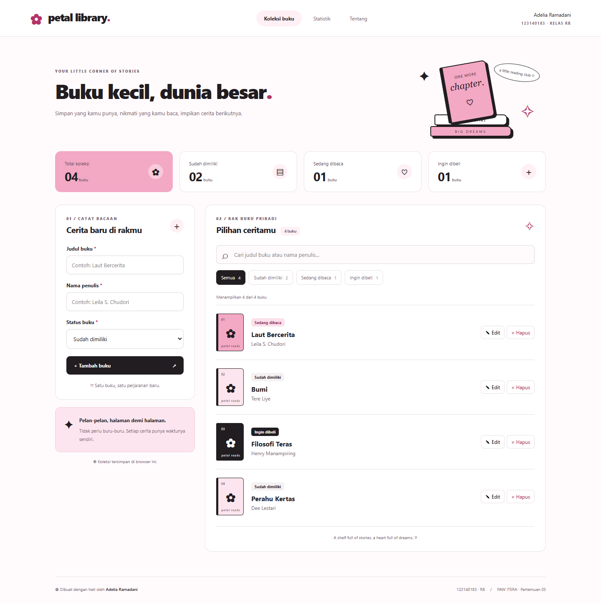
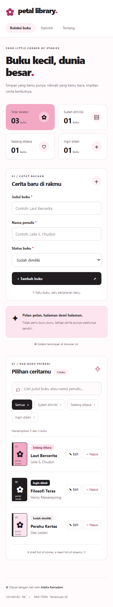
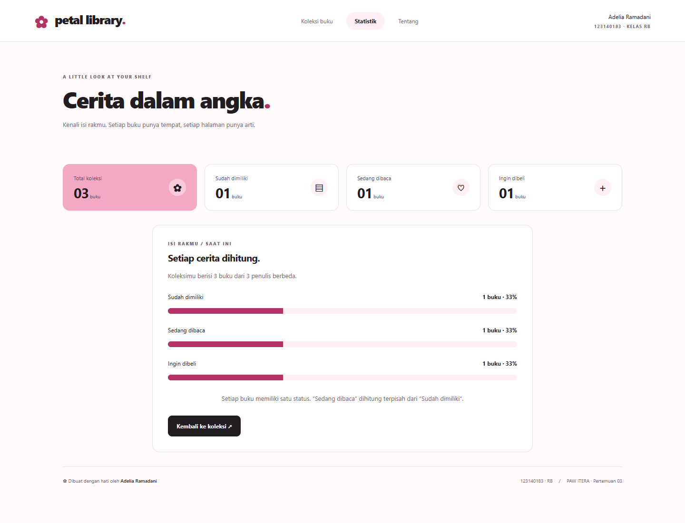
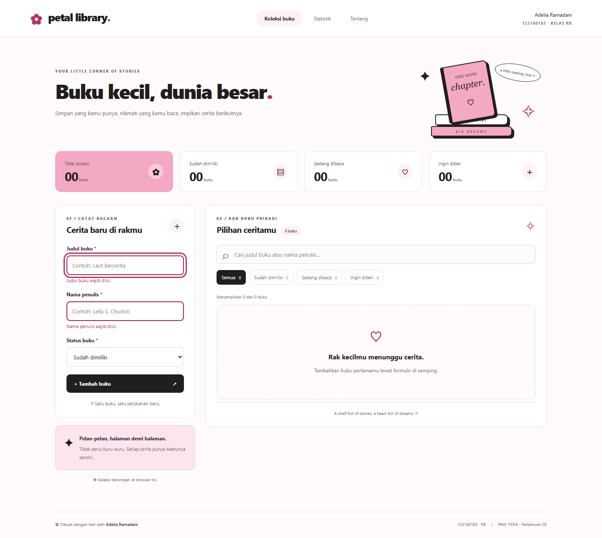
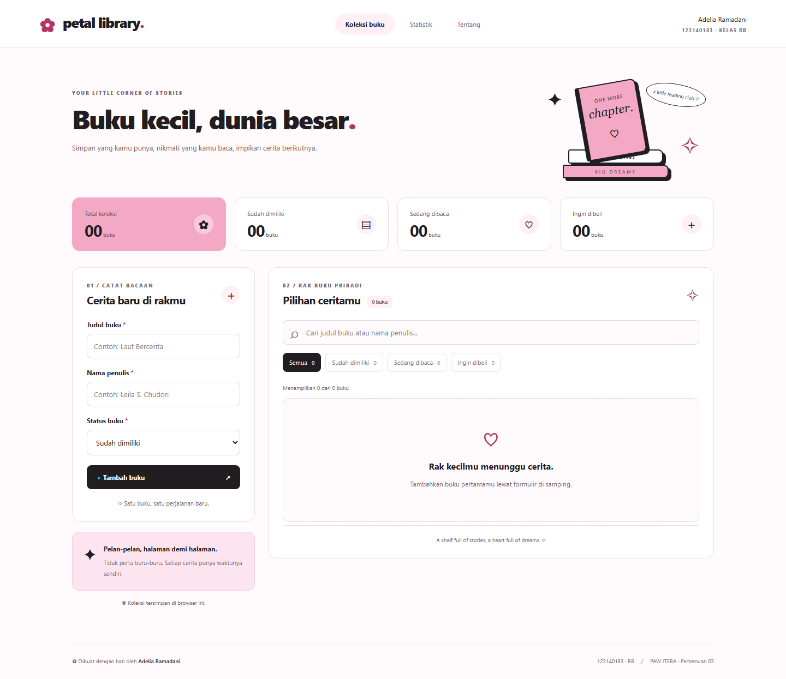
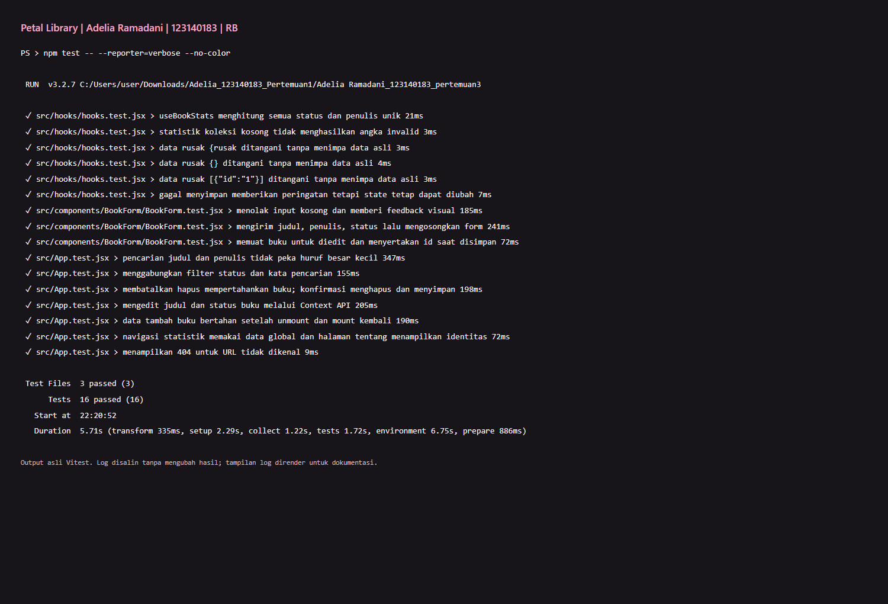

# Petal Library — Manajemen Buku Pribadi

**Adelia Ramadani · NIM 123140183 · Kelas RB**<br>
Praktikum Pengembangan Aplikasi Web ITERA — Pertemuan 3

Petal Library adalah aplikasi React untuk mencatat buku yang sudah dimiliki, sedang dibaca, atau ingin dibeli. Tema pink, hitam, dan putih melanjutkan tugas sebelumnya, dengan ilustrasi statis serta **tanpa animasi, transition, atau motion**. Project ini terpisah dari latihan dan tugas pertemuan sebelumnya.

## Instalasi dan menjalankan di VS Code

Prasyarat: Node.js **20.19+ atau 22.12+** (disarankan Node LTS yang memenuhi versi tersebut), npm, dan VS Code. Persyaratan runtime mengikuti [panduan Vite](https://vite.dev/guide/).

1. Clone repository dan buka folder project melalui VS Code:

   ```bash
   git clone https://github.com/07-183-AdeliaRamadani/pemrograman_web_itera_123140183.git
   cd pemrograman_web_itera_123140183
   cd "Adelia Ramadani_123140183_pertemuan3"
   code .
   ```

2. Di terminal VS Code, jalankan:

   ```bash
   npm install
   npm run dev
   ```

3. Buka alamat yang dicetak Vite, biasanya **http://127.0.0.1:5173**. Aplikasi dijalankan melalui Vite, bukan dengan membuka `index.html` langsung atau Live Server.

Jika PowerShell membatasi `npm.ps1`, gunakan `npm.cmd install` dan `npm.cmd run dev`. File `package-lock.json` disertakan; `npm ci` dapat digunakan untuk memasang versi persis yang dikunci.

## Fitur dan cara penggunaan

| Fitur       | Cara menggunakan                                                                                                             |
| ----------- | ---------------------------------------------------------------------------------------------------------------------------- |
| Tambah buku | Isi judul dan nama penulis, pilih status, lalu klik **Tambah buku**.                                                         |
| Edit buku   | Klik **Edit** pada buku, ubah data di formulir, lalu **Simpan perubahan**. **Batal mengedit** mengembalikan formulir tambah. |
| Hapus buku  | Klik **Hapus**, lalu konfirmasi **Ya, hapus buku**. Pilih **Batal** atau tekan Escape untuk membatalkan.                     |
| Filter      | Pilih Semua, Sudah dimiliki (`milik`), Sedang dibaca (`baca`), atau Ingin dibeli (`beli`).                                   |
| Pencarian   | Cari judul atau nama penulis tanpa membedakan huruf besar/kecil. Dapat digabung dengan filter status.                        |
| Statistik   | Lihat jumlah per status, persentase distribusi, dan jumlah penulis unik.                                                     |
| Penyimpanan | Koleksi otomatis disimpan di localStorage dan dimuat kembali setelah refresh.                                                |
| Validasi    | Kolom kosong/spasi ditolak, pesan ditampilkan di bawah kolom, dan fokus diarahkan ke kolom pertama yang belum valid.         |

Halaman: `/` (koleksi), `/stats` (statistik), `/about` (panduan dan identitas), dan halaman 404 untuk alamat lainnya. Setiap buku mempunyai **satu** status; kategori `baca` dihitung terpisah dari `milik`.

Koleksi awal kosong. Buku pada screenshot adalah data contoh yang dimasukkan saat pengujian browser. Data bersifat lokal per browser dan origin, bukan sinkronisasi akun. Menghapus data situs akan menghapus koleksi. Jika format JSON rusak, aplikasi memberi peringatan dan mempertahankan data lama sampai koleksi diubah. Jika penyimpanan penuh/diblokir, perubahan tetap berfungsi dalam sesi saat ini dan peringatan menjelaskan bahwa data belum tersimpan.

## Screenshot aplikasi

### Koleksi — desktop



### Koleksi — ponsel



### Statistik



### Validasi form



### Kondisi awal



## Penerapan React

| Persyaratan                   | Implementasi                                                                                                                                                                                          |
| ----------------------------- | ----------------------------------------------------------------------------------------------------------------------------------------------------------------------------------------------------- |
| Functional components dan JSX | Seluruh komponen menggunakan fungsi React.                                                                                                                                                            |
| `useState`                    | Input formulir, error, pencarian, filter, mode edit, konfirmasi hapus, dan pesan hasil aksi.                                                                                                          |
| `useEffect`                   | Menyimpan koleksi otomatis, mengelola native dialog, dan memfokuskan formulir edit.                                                                                                                   |
| Komponen reusable             | Header, StatCard, BookForm, BookFilter, BookList, Navbar, ConfirmDialog.                                                                                                                              |
| Props dan PropTypes           | Skema data buku dan props komponen dideklarasikan melalui `propTypes`; komponen tanpa props mendeklarasikan skema kosong. React 18 digunakan agar pemeriksaan PropTypes tetap aktif pada development. |
| Context API                   | `BookProvider` menyediakan koleksi, CRUD, statistik, dan pesan penyimpanan kepada halaman.                                                                                                            |
| React Router                  | `BrowserRouter`, `NavLink`, `Routes`, dan `Route` untuk navigasi tanpa refresh.                                                                                                                       |
| Custom hook 1                 | `useLocalStorage`: lazy initialization, validasi format data, persistensi, dan error penyimpanan.                                                                                                     |
| Custom hook 2                 | `useBookStats`: statistik berdasarkan daftar buku dengan `useMemo`.                                                                                                                                   |
| Immutability                  | Penambahan dengan spread, pengeditan dengan `map`, penghapusan dengan `filter`; semuanya menggunakan functional state updater.                                                                        |

Komentar kode menjelaskan bagian penting: functional updater, kombinasi filter, dan perlindungan data localStorage. Rujukan konsep: [React Hooks](https://react.dev/reference/react/hooks) dan [useEffect](https://react.dev/reference/react/useEffect).

## Struktur folder

```text
Adelia Ramadani_123140183_pertemuan3/
├── docs/                   # Log dan laporan pengujian
├── screenshots/            # Bukti tampilan dan hasil test
├── src/
│   ├── components/
│   │   ├── BookForm/       # Form dan unit test
│   │   ├── BookFilter/
│   │   ├── BookList/
│   │   ├── ConfirmDialog/
│   │   ├── Header/
│   │   ├── Navbar/
│   │   └── StatCard/
│   ├── context/BookContext.jsx
│   ├── hooks/              # useLocalStorage, useBookStats, dan test
│   ├── pages/              # Home, Stats, About, NotFound
│   ├── utils/books.js      # Status, validasi, dan skema PropTypes
│   ├── App.jsx
│   ├── App.css
│   ├── App.test.jsx
│   ├── main.jsx
│   └── setupTests.js
├── .gitignore
├── index.html
├── package.json
├── package-lock.json
└── vite.config.js
```

## Pengujian dan build

```bash
npm test
npm run test:watch
npm run build
npm run preview
```

`npm test` menjalankan Vitest sekali, dengan React Testing Library, user-event, jest-dom, dan JSDOM. Hasil: **3 file test lulus, 16 test lulus**. Skenario meliputi validasi, tambah/edit/hapus, batal hapus, pencarian, kombinasi filter, persistensi, statistik, routing/404, JSON rusak, serta kegagalan localStorage.



Screenshot di atas menampilkan **output terminal aktual** yang dirender dari log untuk dokumentasi, bukan tangkapan jendela PowerShell. Hasil tidak diedit. Teks asli tersedia di [docs/test-output.txt](docs/test-output.txt), dan tampilan log dapat dibuka melalui [docs/hasil-test.html](docs/hasil-test.html).

[Laporan testing lengkap](docs/LAPORAN_TESTING.md) mencatat skenario dan pemeriksaan browser. `npm run build` berhasil menghasilkan build produksi di `dist/`. Browser juga diperiksa pada desktop dan viewport ponsel 390px: tidak ada horizontal overflow, animasi, atau JavaScript page error.

Untuk deployment produksi dengan `BrowserRouter`, hosting perlu mengarahkan URL seperti `/stats` kembali ke `index.html`. Upload repository GitHub pada tugas ini adalah penyimpanan source code; tidak otomatis memublikasikan website.

## Pengumpulan

- Repository: [pemrograman_web_itera_123140183](https://github.com/07-183-AdeliaRamadani/pemrograman_web_itera_123140183)
- Folder: `Adelia Ramadani_123140183_pertemuan3`
- `node_modules/`, `dist/`, dan coverage diabaikan melalui `.gitignore`.
- Tidak memerlukan API key, database, atau backend.
