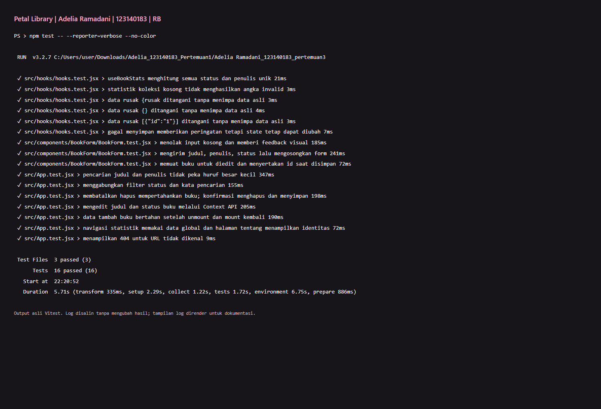

# Laporan Pengujian Petal Library

Adelia Ramadani · 123140183 · RB 
Tanggal pelaksanaan: 24 Oktober 2026 (Asia/Jakarta)

## Lingkungan

Node.js v24.11.0, npm 11.6.1, React 18, Vite 7, Vitest 3.2.7, React Testing Library, JSDOM, dan Microsoft Edge headless. Versi dependensi persis disimpan pada package-lock.json.

## Hasil unit dan integrasi

Perintah: `npm test -- --reporter=verbose --no-color` 
Hasil: **16 passed, 3 test files passed**.

| No. | Skenario                                                            | Hasil |
| --- | ------------------------------------------------------------------- | ----- |
| 1   | Form menolak judul/penulis kosong, menampilkan feedback dan fokus   | Lulus |
| 2   | Form mengirim buku baru dan membersihkan input                      | Lulus |
| 3   | Form edit memuat data lama dan mengirim ID                          | Lulus |
| 4   | Pencarian judul/penulis tanpa peka kapital                          | Lulus |
| 5   | Kombinasi pencarian dengan filter status dan hasil kosong           | Lulus |
| 6   | Batal hapus mempertahankan data; konfirmasi menghapus dan menyimpan | Lulus |
| 7   | Edit judul dan status melalui Context API                           | Lulus |
| 8   | Buku tambahan tetap tersedia setelah unmount/mount                  | Lulus |
| 9   | Navigasi statistik global dan identitas di halaman Tentang          | Lulus |
| 10  | URL tidak dikenal menampilkan 404                                   | Lulus |
| 11  | useBookStats menghitung status dan penulis unik                     | Lulus |
| 12  | Statistik data kosong bernilai nol                                  | Lulus |
| 13  | JSON tidak valid ditangani tanpa menimpa data lama                  | Lulus |
| 14  | JSON objek yang bukan array ditolak                                 | Lulus |
| 15  | Array dengan objek buku tidak lengkap ditolak                       | Lulus |
| 16  | Penyimpanan gagal memberi peringatan tanpa menghentikan state       | Lulus |

Gambar merupakan tangkapan tampilan log terminal aktual yang dirender di browser agar seluruh hasil dapat dibaca, bukan tangkapan terminal native. [Log teks asli](test-output.txt) menyimpan output eksekusi. Implementasi dialog native disimulasikan di JSDOM; perilakunya juga diperiksa melalui browser sungguhan.

## Pemeriksaan browser

- Menambah empat buku dengan variasi status, lalu refresh: koleksi tetap tampil.
- Form kosong menampilkan error dan fokus ke input judul.
- Mengedit judul kemudian menyimpan: judul baru tampil.
- Membatalkan dialog hapus: buku tetap ada; konfirmasi: buku terhapus.
- Filter Ingin dibeli + pencarian nama penulis: tepat satu hasil sesuai.
- Navigasi Statistik dan membuka `/stats` langsung: berhasil.
- Tampilan 1440px dan 390px diperiksa secara visual; tidak ada overflow horizontal di 390px.
- `document.getAnimations()` mengembalikan daftar kosong.
- Tidak ada JavaScript `pageerror` sepanjang pengujian browser.

## Build produksi

`npm run build` berhasil. Build menghasilkan HTML, CSS, dan bundle JavaScript di `dist/`. Folder ini tidak dimasukkan ke Git; build dapat dibuat ulang setelah instalasi dependensi.
