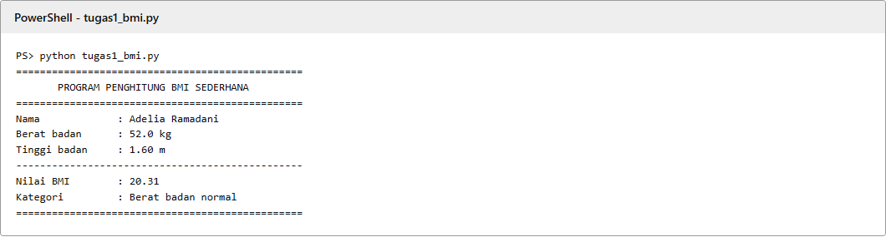
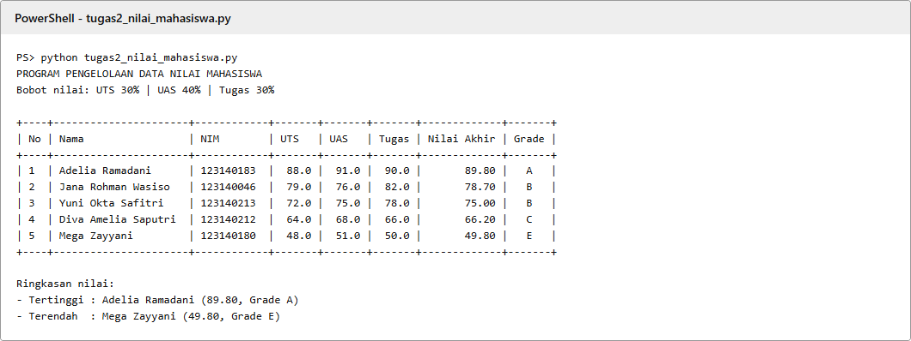
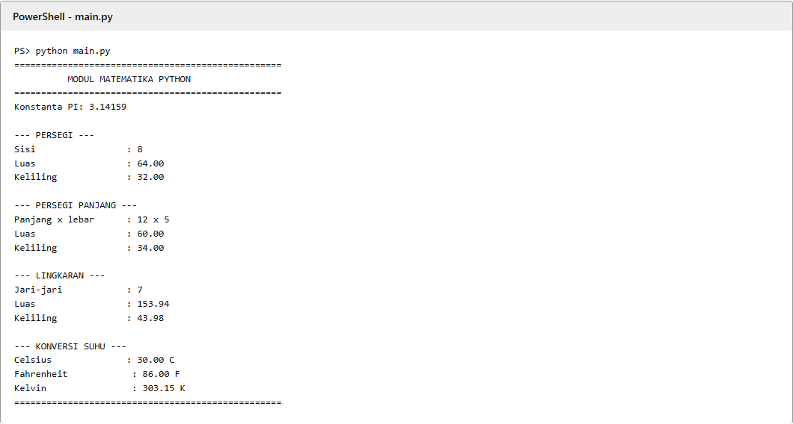
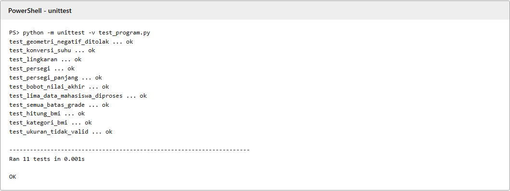

# Praktikum 4 - Dasar Pemrograman Python

**Kelas:** PAW RB<br>
**Repository:** [pemrograman_web_itera_123140183](https://github.com/07-183-AdeliaRamadani/pemrograman_web_itera_123140183)

## Anggota

| No. | Nama | NIM |
| --- | --- | --- |
| 1 | Adelia Ramadani | 123140183 |
| 2 | Jana Rohman Wasiso | 123140046 |
| 3 | Yuni Okta Safitri | 123140213 |
| 4 | Diva Amelia Saputri | 123140212 |
| 5 | Mega Zayyani | 123140180 |

## Isi tugas

Tugas ini merupakan aplikasi konsol Python, sehingga tidak memerlukan website maupun motion/animasi.

| Berkas | Fungsi |
| --- | --- |
| `tugas1_bmi.py` | Menghitung BMI Adelia Ramadani dan menampilkan empat kategori BMI menggunakan `if-elif-else`. |
| `tugas2_nilai_mahasiswa.py` | Mengelola lima dictionary mahasiswa, menghitung nilai akhir (UTS 30%, UAS 40%, tugas 30%), menentukan grade A-E, menampilkan tabel, serta mencari nilai tertinggi dan terendah. |
| `math_operations.py` | Modul kustom berisi konstanta `PI`, fungsi luas dan keliling persegi, persegi panjang, lingkaran, serta dua konversi suhu. |
| `main.py` | Mengimpor modul dengan dua cara dan menjalankan seluruh fungsi geometri serta konversi suhu. |
| `test_program.py` | Pengujian unit standar-library untuk rumus, batas grade, data mahasiswa, geometri, konversi suhu, dan validasi ukuran. |

Semua fungsi memiliki docstring, memakai nama `snake_case`, serta indentasi empat spasi sesuai PEP 8. Nilai pada program adalah data latihan untuk demonstrasi perhitungan, bukan data akademik atau kesehatan aktual.

## Cara menjalankan

Pastikan Python 3.8 atau lebih baru tersedia. Dari folder ini, jalankan:

```powershell
python tugas1_bmi.py
python tugas2_nilai_mahasiswa.py
python main.py
```

Pada sebagian komputer Windows, gunakan `py` sebagai pengganti `python`:

```powershell
py tugas1_bmi.py
py tugas2_nilai_mahasiswa.py
py main.py
```

Untuk memeriksa semua fungsi secara otomatis:

```powershell
python -m unittest -v test_program.py
```

## Bukti eksekusi

Gambar berikut merangkum keluaran aktual dari ketiga skrip dan pengujian unit. Pengujian otomatis menjalankan **11 test** dan seluruhnya lulus.

### Soal 1 - Penghitung BMI



### Soal 2 - Pengelolaan Nilai Mahasiswa



### Soal 3 - Modul Matematika



### Pengujian Unit



## Struktur folder

```text
Adelia Ramadani_123140183_pertemuan4/
├── docs/hasil-eksekusi.html # Versi teks bukti keluaran terminal
├── screenshots/             # Gambar hasil eksekusi
├── .gitignore               # Mengabaikan venv dan cache Python
├── README.md
├── tugas1_bmi.py
├── tugas2_nilai_mahasiswa.py
├── math_operations.py
├── main.py
└── test_program.py
```
